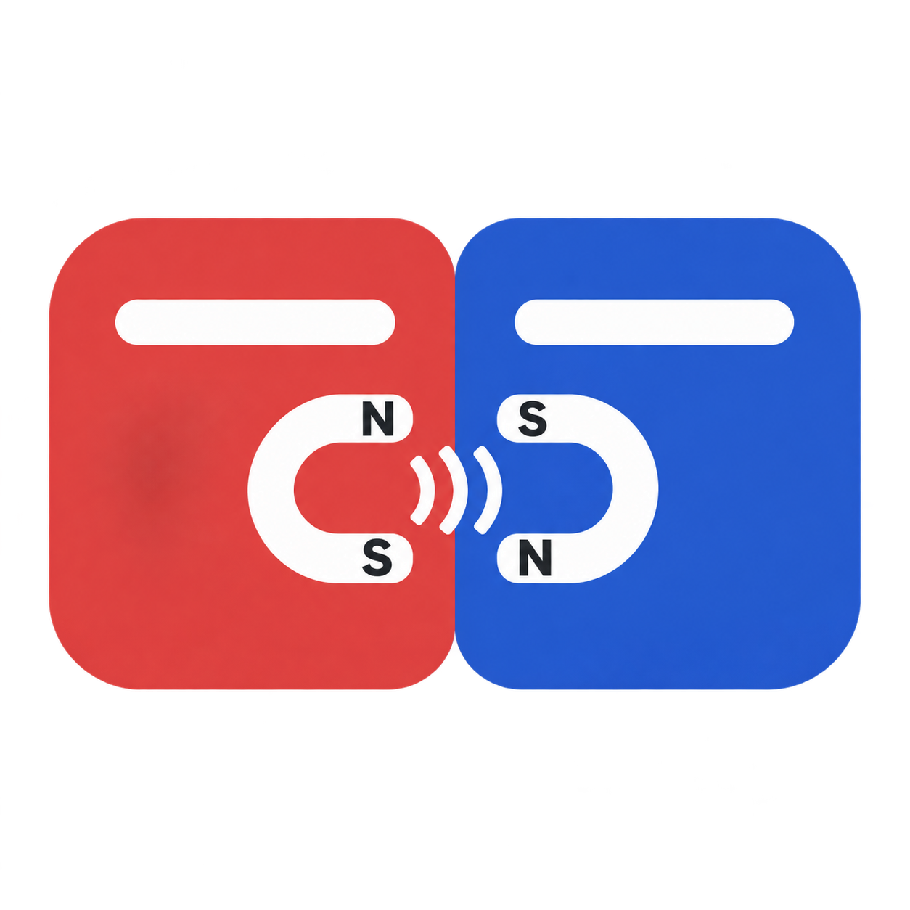

<div align="center">
  
  <h1>magnetic-desk</h1>
  <p><strong>Windows Desktop Magnetic Organizer</strong> — File Widgets · Magnetic Groups · Hover Capsules · Smart Auto-Organization · Notes · Clipboard · Tasks</p>
  <p>
    <a href="https://github.com/Rosszhou/magnetic-desk/releases/latest">
      
    </a>
    
    <a href="LICENSE">
      
    </a>
  </p>
  <p>
    <a href="README.md">简体中文</a> | <strong>English</strong>
  </p>
</div>

---

## Overview

**magnetic-desk** is a local-first Windows desktop organizer built with WinUI 3 and .NET 10. Organize desktop files, shortcuts, and folders inside clean file widgets that snap together into persistent **magnetic groups**—moving, resizing, expanding, and collapsing smoothly as one unit.

- **Offline-ready installer**: Bundles the `.NET 10` and `Windows App SDK` runtimes with zero extra downloads.
- **Local-first storage**: Managed files stay in ordinary folders; settings and automatic snapshots stay local and are never lost during upgrades.
- **Adaptive high-refresh animations**: Collapse and expand transitions adapt smoothly across `60Hz–240Hz+` monitors without square-capsule flashes or frame drops.

---

## Download and install

Download `magnetic-desk_Setup_1.6.0_x64.exe` from [GitHub Releases](https://github.com/Rosszhou/magnetic-desk/releases/latest) and run the installer:

- **Requirements**: 64-bit (x64) Windows 10 version 2004 (build 19041) or later, or Windows 11.
- **Direct in-place upgrades**: Existing installations (`1.5.0` or earlier) are detected automatically and upgraded in place while preserving all settings, layouts, and managed files.
- **SmartScreen notice**: The installer is currently unsigned, so Windows may display an unknown publisher warning. A matching `.sha256` checksum file is published alongside every release.
- **Languages & uninstall**: Supports Simplified Chinese and English (follows system language by default). Uninstall anytime via **Settings → About** or Windows **Installed apps**.

---

## Key features

- **Magnetic docking & coordinated layout**: Drag a widget near another edge and hold for **3 seconds** to snap them into a magnetic group. Drag any title bar to move the entire group; hold **`Ctrl`** while dragging to detach and move a single member. Press **`Ctrl + Z`** to undo layout operations or lock a group's layout.
- **Hover-to-expand capsules**: Defaults to **Hover to auto-expand**, collapsing cleanly into compact capsules after **5 seconds** of pointer inactivity. Choose from 5 capsule styles (Frosted Ring, Soft Fill, Segments, Classic Black, Classic White) and pin widgets or groups on top.
- **Smart Desktop Organization**: Classifies desktop files into Apps & Shortcuts, Documents, Images, Media, Installers, Archives, **Code & Scripts**, and **Folders**, with broad modern/CJK format coverage and safety guards for OneDrive placeholders, downloader temp files, and Office lock files.
- **Companion widgets & local backup**: Add Notes, Clipboard History, and Todo widgets from the widget `+` menu. Streamlined Settings with one-click Balanced / Memory Saver modes and automatic local backup snapshots.

---

## What's new in v1.6.0

- Eliminated collapse square-capsule flash and high-refresh-rate stutter across `60Hz–240Hz+` displays.
- Fixed magnetic group top-row alignment drift after collapse/expand cycles.
- Upgraded desktop auto-organization with standalone **Code & Scripts** and **Folders** categories, expanded format coverage, and stronger safety guards.
- Streamlined Settings UI, set Hover to auto-expand as the default display behavior, and fixed in-place upgrade cleanup for existing installs.

See [CHANGELOG.md](CHANGELOG.md) for the full release history.

---

## Build and verification

Development requires Windows, a `.NET 10 SDK` matching [global.json](global.json), and Windows SDK `10.0.22621.0`. Building native helpers and running the full test suite additionally requires the pinned Rust MSVC toolchain and Visual C++ build tools.

```powershell
dotnet restore src/magnetic-desk/magnetic-desk.csproj -p:Platform=x64 -p:RuntimeIdentifier=win-x64
dotnet build src/magnetic-desk/magnetic-desk.csproj -c Debug -p:Platform=x64 -p:RuntimeIdentifier=win-x64 -p:WindowsAppSDKSelfContained=true -p:MagneticDeskShellThumbnailProxy=false
dotnet test tests/magnetic-desk.ManagedRegression/magnetic-desk.ManagedRegression.csproj -p:Platform=x64 -p:RuntimeIdentifier=win-x64
```

See [native/README.md](native/README.md) for native helper build instructions.

---

## License

Licensed under **GPL-3.0-only**. Copyright and upstream modification notices are provided in [NOTICE](NOTICE), with the full license in [LICENSE](LICENSE).
