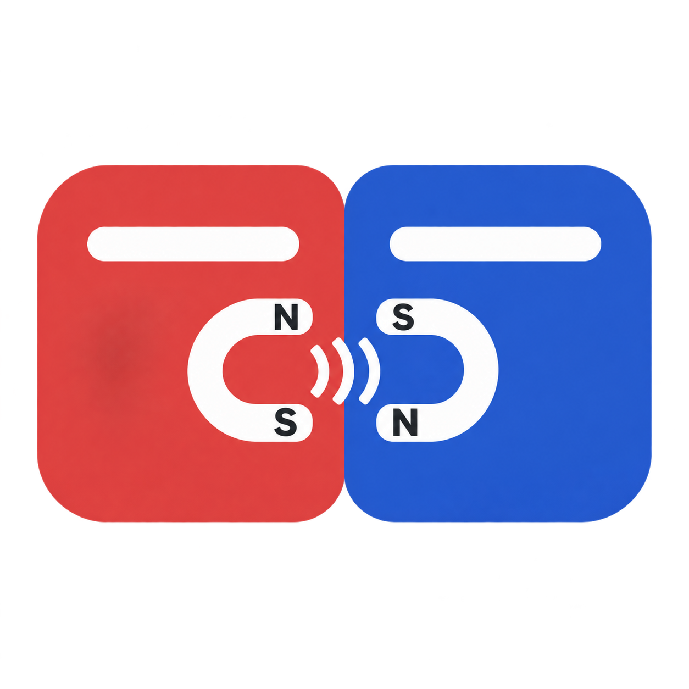

<div align="center">
  
  <h1>magnetic-desk</h1>
  <p><strong>Windows 桌面磁吸整理工具</strong> —— 文件格子 · 磁吸组合 · 悬停胶囊收纳 · 智能自动整理桌面 · 便签 · 剪贴板 · 待办</p>
  <p>
    <a href="https://github.com/Rosszhou/magnetic-desk/releases/latest">
      
    </a>
    
    <a href="LICENSE">
      
    </a>
  </p>
  <p>
    <strong>简体中文</strong> | <a href="README.en.md">English</a>
  </p>
</div>

---

## 简介

**magnetic-desk** 是一款基于 WinUI 3 与 .NET 10 打造的 Windows 本地桌面整理工具。你可以把桌面文件、快捷方式和文件夹收纳到美观轻巧的「文件格子」中，像积木一样通过**磁吸组合**把多个格子拼在一起联动移动、同步缩放、整组悬停展开与收起，让杂乱的桌面瞬间清爽有序。

- **离线即用**：安装包内置完整 `.NET 10` 与 `Windows App SDK` 运行组件，无需额外下载运行库。
- **本地优先**：文件保存在普通目录中，配置与自动备份完全存于本地，卸载不会删除你的个人文件。
- **高刷丝滑**：展开与收起动画自适应 `60Hz–240Hz+` 全刷新率显示器，告别掉帧与闪烁。

---

## 下载与安装

前往 [GitHub Releases 最新版本页](https://github.com/Rosszhou/magnetic-desk/releases/latest) 下载 `magnetic-desk_Setup_1.6.0_x64.exe`，双击运行即可：

- **系统要求**：Windows 10 2004（内部版本 19041）及以上，或 Windows 11（64 位 x64）。
- **旧版直接升级**：已安装 `1.5.0` 或更早版本的用户，直接运行新版安装包即可**自动识别原目录原地覆盖升级**，完整保留所有设置、格子布局与收纳文件。
- **关于安全提示**：安装包目前未做商业代码签名，Windows SmartScreen 可能会提示“未知发布者”；下载页附带对应的 `.sha256` 校验文件可供核对完整性。
- **语言与卸载**：内置简体中文与英文（跟随系统自动选择），可在软件「设置 → 关于」或 Windows「已安装的应用」中随时卸载。

---

## 核心功能

### 1. 磁吸组合与自由排布
- **靠近即吸合**：拖动任意格子靠近另一个格子的边缘并停留 **3 秒**（会显示磁吸预览轮廓与倒计时动画），松手即自动吸合编组。
- **整组联动**：拖动标题栏即可整体移动整个磁吸组合；按住 **`Ctrl`** 拖动可将单个成员脱离组合并单独移动。
- **智能缩放与对齐**：调整组合中任意格子的大小时，相邻格子会自动联动避让，且展开后的顶边/边缘对齐关系在反复收起与展开后保持稳定不偏移。
- **撤销与锁定**：支持按 **`Ctrl + Z`** 撤销组合、拆分、移动与缩放操作，也可一键锁定整组布局防止误触。

### 2. 胶囊收纳与悬停自动展开
- **默认悬停展开**：格子默认采用「悬停自动展开」模式，平时收起为紧凑的胶囊条不遮挡壁纸，鼠标移上去自动展开，移开 **5 秒**后自动收回。
- **5 款胶囊外观**：支持「磨砂圆环」「柔色填充」「分段刻度」「经典黑」「经典白」，支持整组统一切换与实时预览。
- **整组置顶**：点击标题栏或胶囊右侧图钉按钮，可将单个格子或整个磁吸组合固定在桌面最前。

### 3. 智能桌面整理与自动收纳
- **一键分类整理**：自动扫描桌面文件并归类到对应格子，支持**应用与快捷方式、文档、图片、音视频、安装包、压缩包、代码与脚本、文件夹**等分类。
- **现代与中文常用格式全覆盖**：内置识别 WPS、`.ofd`、`.caj`、`.avif`、`.jxl`、相机 RAW、设计稿、电子书、思维导图、`.opus`、`.zst`、`.apk`、`.torrent` 等常见格式。
- **安全防误收机制**：自动避开 OneDrive 云端占位文件、浏览器下载临时文件、Office 正在编辑的锁文件，并支持拖出桌面后的智能抑制，不打断正常工作流。

### 4. 轻量功能格子与本地备份
- **实用功能格子**：在文件格子标题栏 `+` 菜单中可按需添加**便签**、**剪贴板历史**、**待办**格子。
- **精简直观的设置页**：首页提供「均衡 / 省内存」性能模式一键切换，底层内存与缓存策略收纳在高级折叠面板中，开箱即懂。
- **本地备份与恢复**：支持定时自动备份与一键快照还原；数据存放于 `%LocalAppData%\magnetic-desk`，默认收纳目录位于 `%UserProfile%\magnetic-desk`。

---

## 常用交互速查

| 操作 | 效果 |
| --- | --- |
| 拖动标题栏 | 移动单个格子或整个磁吸组合 |
| 按住 `Ctrl` + 拖动标题栏 | 将当前格子从磁吸组合中脱离并单独移动 |
| 拖动格子靠近另一格子边缘停留 3 秒 | 触发磁吸倒计时并合并为磁吸组合 |
| 鼠标悬停在胶囊上 / 离开 5 秒 | 自动展开格子 / 倒计时结束后自动收起 |
| 聚焦格子后按 `Ctrl + Z` | 撤销上一次组合、拆分、移动或缩放操作 |
| 点击标题栏 `…` 或右键格子空白处 | 切换胶囊外观、磁吸动画、锁定布局或打开设置 |

---

## v1.6.0 更新亮点

- **全刷新率流畅动画**：彻底消除收起时的方形胶囊闪现与高刷屏掉帧，自适应 `60Hz–240Hz+` 显示器。
- **磁吸顶边对齐稳定**：修复 5 格等复杂磁吸组调齐后收起再展开变不平的问题。
- **整理规则大幅升级**：直接展示「代码与脚本」「文件夹」独立分类，扩充现代/中文文件格式并增强安全防误收。
- **界面更清爽**：默认启用「悬停自动展开」，精简设置页与入口，移除独立搜索格子与新建文件夹映射入口。
- **旧版无缝覆盖升级**：修复升级清理脚本文件名不匹配问题，确保老用户可直接运行新版安装包平滑升级。

完整变更记录请查看 [CHANGELOG.md](CHANGELOG.md)，详细功能说明见 [magnetic-desk.md](magnetic-desk.md)。

---

## 开发者构建指南

开发环境需要 Windows、与 [global.json](global.json) 匹配的 `.NET 10 SDK` 以及支持 `10.0.22621.0` 的 Windows SDK；编译原生辅助组件及运行完整测试还需 Rust MSVC 工具链和 Visual C++ 构建工具。

```powershell
# 还原并构建 x64 托管应用（携带自包含 Windows App SDK 运行时）
dotnet restore src/magnetic-desk/magnetic-desk.csproj -p:Platform=x64 -p:RuntimeIdentifier=win-x64
dotnet build src/magnetic-desk/magnetic-desk.csproj -c Debug -p:Platform=x64 -p:RuntimeIdentifier=win-x64 -p:WindowsAppSDKSelfContained=true -p:MagneticDeskShellThumbnailProxy=false

# 运行托管核心回归测试
dotnet test tests/magnetic-desk.ManagedRegression/magnetic-desk.ManagedRegression.csproj -p:Platform=x64 -p:RuntimeIdentifier=win-x64
```

原生组件构建说明请参阅 [native/README.md](native/README.md)。

### 仓库结构

- `src/`：主程序、更新辅助程序与独立卸载器源码
- `native/`：Rust 原生 Shell 交互与缩略图代理组件源码
- `installer/`：Inno Setup 安装与原地升级脚本
- `tests/`：单元测试、契约测试与集成测试
- `scripts/`：构建、打包与发布校验脚本

---

## 许可协议

本项目采用 **GPL-3.0-only** 开源协议发布。版权与上游修改声明请参阅 [NOTICE](NOTICE)，完整协议条款请参阅 [LICENSE](LICENSE)。
